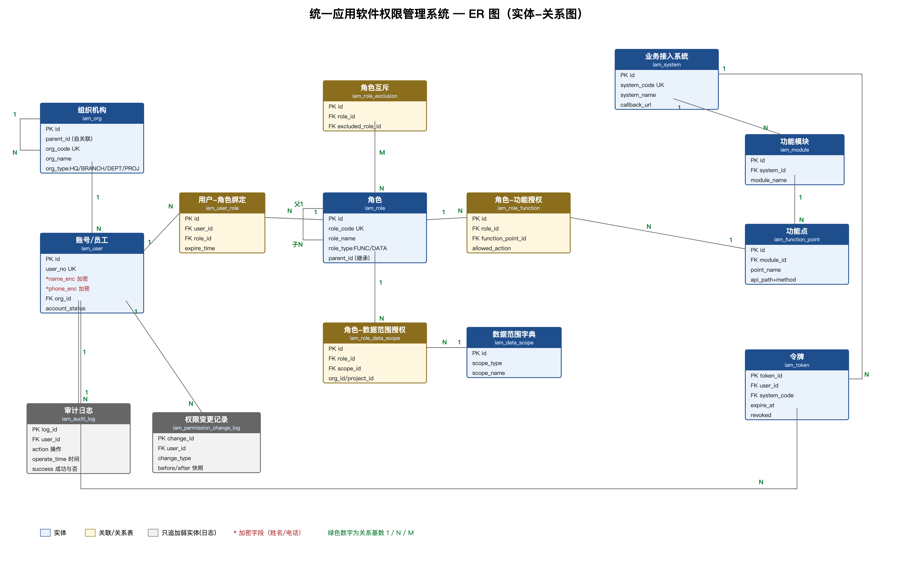

= 统一应用软件权限管理系统 数据库设计说明书
:doctype: book
:toc: left

[cols="1,1"]
|===
| 项目 | 内容

| 文档名称 | 统一应用软件权限管理系统 数据库设计说明书

| 项目全称 | 统一应用软件权限管理系统（RBAC 统一身份与权限平台）

| 文档版本 | V1.2

| 修订说明 | V1.2（2026-10-26）：按需求文档 V1.1 整理——第 1 章约定改为与实际表结构一致，后续阶段的设计标注实现阶段，新增第 7 章需求追踪。V1.1（2026-10-26）：RBAC0 相关 8 张表与建表脚本 `src/main/resources/db/schema.sql`、JPA 实体逐字段对齐；新增 `password_hash`；第 5 章 DDL 改为实际建表脚本；新增初始化数据说明；嵌入 ER 图

| 编制单位 | 信息中心 / 系统架构组

| 上游依据 | 《需求规格说明书》V1.1、《详细设计说明书》V2.0

| 适用阶段 | 详细设计阶段（课程期末大作业交付物）

| 目标数据库 | MySQL 8.0（InnoDB / utf8mb4）

| 密级 | 内部
|===

'''

== 1. 设计约定

=== 1.1 命名规范

[cols="1,1,1"]
|===
| 对象 | 规范 | 示例

| 表名 | 小写下划线，统一前缀 `iam_`，单数名词 | `iam_user`、`iam_role_function`

| 字段名 | 小写下划线，语义完整，避免缩写歧义 | `account_status`、`function_point_id`

| 主键 | 统一 `id`（关联表）或业务主键名（`log_id`、`change_id`、`token_id`） | `iam_user.id`

| 外键字段 | `<被引用表单数>_id` | `org_id`、`role_id`、`function_point_id`

| 唯一索引 | `uk_<表简称>_<字段>` | `uk_user_user_no`

| 普通索引 | `idx_<表简称>_<字段>` | `idx_user_org`

| 外键约束 | 逻辑外键，不建物理约束（见 4.2） | `iam_user.org_id → iam_org.id`

| 布尔字段 | `is_` 前缀或语义名，`tinyint`，0/1 | `is_deleted`、`revoked`
|===

=== 1.2 字符集与排序规则

* 数据库、表、字符字段统一 `utf8mb4`，排序规则 `utf8mb4_0900_ai_ci`（MySQL 8.0 默认，支持中文与 emoji）。
* 存储引擎统一 `InnoDB`，支持事务与行级锁。
* 时间字段统一 `datetime`（秒级精度，对应 Java `LocalDateTime`），默认 `CURRENT_TIMESTAMP`。

=== 1.3 主键策略

* 采用 _BIGINT 自增主键_（`bigint auto_increment`，有符号，与 Java `Long` 一一对应），避免 UUID 造成的索引膨胀与页分裂；对外暴露时通过编码字段（`user_no`、`role_code`、`system_code`）而非主键。
* 例外：令牌表 `iam_token` 以 `token_id`（UUID 字符串）为主键，令牌本身只存哈希。
* 审计日志表 `iam_audit_log` 主键 `log_id` 采用 `bigint auto_increment`，保证只追加写入的顺序性。
* 关联表（`iam_user_role`、`iam_role_function`、`iam_role_data_scope`）采用自增 `id` 主键 + 业务唯一索引，便于扩展字段（有效期、授权人等）。

=== 1.4 审计与软删除策略

[cols="1,1"]
|===
| 策略 | 说明

| 时间字段 | 所有表含 `created_at`；会被修改的表另含 `updated_at`，由 `ON UPDATE CURRENT_TIMESTAMP` 自动维护（应用层写入时也显式赋值）。只追加的表（`iam_token` 除吊销外不修改、`iam_role_function`、`iam_role_exclusion`、两张日志表）不设 `updated_at`

| 操作人字段 | 由管理员维护的主数据表（`iam_user`、`iam_role`、`iam_org`）含 `created_by`、`updated_by`；关联表只记录授权人（`iam_user_role.grant_by`、`iam_role_function.created_by` 等）；接入登记表（`iam_system`、`iam_module`、`iam_function_point`）暂不记录操作人，由审计日志追溯（RBAC3）

| 软删除 | 主数据表（`iam_user`、`iam_role`、`iam_org`、`iam_system`、`iam_module`、`iam_function_point`）含 `is_deleted tinyint`，删除即置 1，查询过滤 `is_deleted = 0`。*账号与日志不做物理删除*（FR-05、FR-45）

| 关联表的回收 | `iam_user_role` 不软删除，用 `status` 表示 `ACTIVE / EXPIRED / REVOKED`，回收后再授予复用原记录；`iam_role_function` 解绑时物理删除该行——绑定关系本身不需要保留历史，变更历史由 `iam_permission_change_log` 记录（RBAC3）

| 账号封存 | 通过 `account_status = 'SEALED'` 表达，不删除记录；`is_deleted` 仅用于误建账号的纠错

| 审计日志 | `iam_audit_log` *只追加*：不设 `updated_at`、不设 `is_deleted`，禁止 UPDATE / DELETE（见 4.3，RBAC3 阶段）

| 权限变更快照 | `iam_permission_change_log` 只追加，记录变更前后 JSON 快照，支持追溯（FR-42，RBAC3 阶段）
|===

=== 1.5 敏感字段加密说明

[cols="1,1,1"]
|===
| 字段 | 存储方式 | 说明

| `iam_user.password_hash` | PBKDF2-HMAC-SHA256，16 字节随机盐，65536 次迭代，256 位输出 | 格式 `Base64(盐):Base64(哈希)`；不存明文、不可逆；校验时常量时间比较，防时序攻击

| `iam_user.name_enc` | AES-256-GCM（或国密 SM4）密文，Base64 编码 | 加密姓名；另存 `name_hash` 用于等值检索与去重

| `iam_user.phone_enc` | 同上 | 加密电话；另存 `phone_hash` 用于等值检索

| 密钥管理 | 目标：密钥由独立 KMS/密钥管理服务托管，**禁止硬编码**（NFR-01）。当前实现：读取 `application.yml` 的 `crypto.aes-key`，部署时须用环境变量覆盖 | 当前密文格式 `Base64(IV + 密文 + Tag)`；后续可加版本号前缀支持密钥轮换

| 展示脱敏 | 应用层（M11 加密脱敏组件）按规则遮蔽：姓名保留姓氏（`张*`）、电话中间四位掩码（`138****5678`） | 明文查看需授权并记录审计日志（FR-49、FR-50）

| 检索哈希 | `name_hash`、`phone_hash`、`iam_token.token_hash` 为 SHA-256(原文 + 密钥) 的十六进制串（带密钥的哈希，可防止离线撞库；不是标准 HMAC，后续可替换为 HMAC-SHA256） | 密文字段不可直接 LIKE 查询；等值查询走哈希字段。RBAC0 未提供按姓名 / 电话检索的接口，因此暂未给这两个哈希字段建索引
|===

说明：`name_enc`、`phone_enc` 字段类型为 `varbinary(512)`（存密文二进制）或 `varchar(512)`（存 Base64 密文）。本设计采用 `varchar(512)` 便于跨语言与运维排查，密文长度按 AES-GCM 最大明文 128 字节估算。

=== 1.6 实现阶段与表范围

课程设计分三次检查逐步实现 RBAC0 → RBAC1 → RBAC3。本文档第 3 章给出全部 14 张表的目标设计，其中 **RBAC0 阶段已实现 8 张表**，与建表脚本 `schema.sql`、JPA 实体完全一致，并已在 MySQL 8.0 上导入验证。

[cols="1,2,1"]
|===
| 阶段 | 表 | 状态

| RBAC0（第一次检查） | `iam_user`、`iam_role`、`iam_user_role`、`iam_system`、`iam_module`、`iam_function_point`、`iam_role_function`、`iam_token` | 已实现

| RBAC1（角色继承） | `iam_role.parent_id`（字段已预留） | 待实现

| RBAC3（约束 + 数据权限 + 审计） | `iam_org`、`iam_role_exclusion`、`iam_data_scope`、`iam_role_data_scope`、`iam_audit_log`、`iam_permission_change_log` | 待实现，实现时同步更新 `schema.sql`
|===

RBAC0 的核心是"用户—角色—权限"两个多对多关系：`iam_user` ↔ `iam_user_role` ↔ `iam_role` ↔ `iam_role_function` ↔ `iam_function_point`。`iam_system → iam_module → iam_function_point` 用于把功能点归属到接入系统，`iam_token` 记录登录令牌以支持登出与吊销。

'''

== 2. 概念模型说明（供 ER 图绘制）

=== 2.1 实体清单

[cols="1,1,1,1"]
|===
| 编号 | 实体 | 中文名 | 说明

| E01 | 组织机构 | iam_org | 多级树：总公司→分公司→部门→项目经理部

| E02 | 账号/员工 | iam_user | 10000 名员工统一账号，姓名电话加密

| E03 | 角色 | iam_role | 功能角色/岗位型数据角色，支持继承与互斥

| E04 | 角色互斥 | iam_role_exclusion | 两角色不可同时授予同一用户

| E05 | 用户-角色绑定 | iam_user_role | 含临时授权有效期

| E06 | 业务接入系统 | iam_system | 18 套在跑系统登记

| E07 | 功能模块 | iam_module | 系统下的模块

| E08 | 功能点 | iam_function_point | 约 359 个，含 API 映射与操作取值

| E09 | 角色-功能权限 | iam_role_function | 角色对功能点的操作授权

| E10 | 数据范围字典 | iam_data_scope | 全公司/本分公司/本部门/本项目/本人

| E11 | 角色-数据范围授权 | iam_role_data_scope | 角色对数据范围的授权（可绑定组织/项目）

| E12 | 令牌 | iam_token | SSO 令牌，含吊销状态

| E13 | 审计日志 | iam_audit_log | 只追加、永久保存

| E14 | 权限变更快照 | iam_permission_change_log | 变更前后快照，支持追溯
|===

缓存（Redis）不建表，见 4.4 说明。

各实体的实现阶段见 1.6。

=== 2.2 实体关系与基数

[cols="1,1,1,1"]
|===
| 编号 | 关系 | 基数 | 说明

| R01 | 组织机构 自关联（父子） | 1:N | `parent_id` 指向上级；`ancestors` 存祖先路径便于子树查询

| R02 | 账号 N:1 组织机构 | N:1 | 一个账号归属一个组织节点；一个组织有多个账号

| R03 | 账号 M:N 角色 | M:N | 经 `iam_user_role` 关联；含有效期（临时授权）

| R04 | 角色 自关联（继承） | 1:N | `parent_id` 指向父角色；子角色继承父角色权限，禁止循环

| R05 | 角色 M:N 角色（互斥） | M:N | 经 `iam_role_exclusion` 关联；互斥关系对称

| R06 | 角色 M:N 功能点 | M:N | 经 `iam_role_function` 关联；携带 `allowed_action`

| R07 | 角色 M:N 数据范围 | M:N | 经 `iam_role_data_scope` 关联；可绑定 `org_id`/`project_id`

| R08 | 业务系统 1:N 功能模块 | 1:N | 一个系统含多个模块

| R09 | 功能模块 1:N 功能点 | 1:N | 一个模块含多个功能点

| R10 | 功能点 1:N 角色-功能权限 | 1:N | 一个功能点被多个角色授权

| R11 | 账号 1:N 令牌 | 1:N | 一个账号可持有多系统令牌

| R12 | 业务系统 1:N 令牌 | 1:N | 令牌按 `system_code` 区分受众

| R13 | 账号 1:N 审计日志 | 1:N | 日志保留 `user_id` 与 `username` 快照

| R14 | 账号 1:N 权限变更快照 | 1:N | 每次变更一条，含前后快照

| R15 | 数据范围字典 1:N 角色-数据范围授权 | 1:N | 字典项被多次引用
|===

=== 2.3 ER 图绘制要点

* 以 `iam_user`、`iam_role`、`iam_function_point` 为三个核心实体，`iam_user_role`、`iam_role_function`、`iam_role_data_scope` 为三张关联表。
* `iam_org` 为自关联树，`iam_role` 为自关联继承树，`iam_role_exclusion` 为角色自关联的 M:N 互斥边。
* `iam_system → iam_module → iam_function_point` 为三级 1:N 链。
* `iam_audit_log`、`iam_permission_change_log` 为只追加的弱依赖实体（不设外键强约束，保留快照字段）。

.统一应用软件权限管理系统 ER 图（全部 14 个实体，图中仅列关键字段，完整字段见第 3 章）

'''

== 3. 逻辑表结构清单

=== 3.1 iam_org 组织机构（RBAC3 阶段实现）

[cols="1,1,1,1,1"]
|===
| 字段名 | 类型 | 可空 | 主键/外键 | 说明

| id | bigint | 否 | PK | 主键

| parent_id | bigint | 是 | FK→iam_org.id | 上级组织；根节点为 NULL

| ancestors | varchar(500) | 否 |  | 祖先路径，逗号分隔 ID，如 `0,1,12`，便于子树查询

| org_code | varchar(64) | 否 | UK | 组织编码

| org_name | varchar(128) | 否 |  | 组织名称

| org_type | varchar(16) | 否 |  | 类型：HQ 总公司 / BRANCH 分公司 / DEPT 部门 / PROJECT 项目部

| org_level | tinyint | 否 |  | 层级：1 总公司 / 2 分公司 / 3 部门 / 4 项目部

| leader_user_id | bigint | 是 | FK→iam_user.id | 负责人

| sort_no | int | 否 |  | 同级排序

| status | varchar(16) | 否 |  | 状态：ACTIVE 正常 / DISABLED 停用

| is_deleted | tinyint | 否 |  | 软删除标记

| created_at | datetime | 否 |  | 创建时间

| updated_at | datetime | 否 |  | 更新时间

| created_by | bigint | 是 |  | 创建人

| updated_by | bigint | 是 |  | 更新人
|===

=== 3.2 iam_user 账号/员工（RBAC0 已实现）

[cols="1,1,1,1,1"]
|===
| 字段名 | 类型 | 可空 | 主键/外键 | 说明

| id | bigint | 否 | PK | 主键

| user_no | varchar(32) | 否 | UK | 账号/工号，唯一，即登录名

| password_hash | varchar(128) | 否 |  | 登录密码哈希（PBKDF2，见 1.5）

| name_enc | varchar(512) | 否 |  | **加密姓名**（密文）

| name_hash | varchar(64) | 是 |  | 姓名检索哈希（见 1.5）

| phone_enc | varchar(512) | 是 |  | **加密电话**（密文）

| phone_hash | varchar(64) | 是 |  | 电话检索哈希（见 1.5）

| org_id | bigint | 否 | FK→iam_org.id | 所属组织

| post | varchar(64) | 是 |  | 岗位（安全员/预算员/质检员等）

| account_status | varchar(16) | 否 |  | 状态：NORMAL 正常 / DISABLED 停用 / SEALED 封存 / LOCKED 锁定

| leave_time | datetime | 是 |  | 离职时间（封存时写入）

| last_login_at | datetime | 是 |  | 最近登录时间

| is_deleted | tinyint | 否 |  | 软删除标记（账号不物理删除）

| created_at | datetime | 否 |  | 创建时间

| updated_at | datetime | 否 |  | 更新时间

| created_by | bigint | 是 |  | 创建人

| updated_by | bigint | 是 |  | 更新人
|===

=== 3.3 iam_role 角色（RBAC0 已实现）

[cols="1,1,1,1,1"]
|===
| 字段名 | 类型 | 可空 | 主键/外键 | 说明

| id | bigint | 否 | PK | 主键

| role_code | varchar(64) | 否 | UK | 角色编码

| role_name | varchar(128) | 否 |  | 角色名称

| role_type | varchar(16) | 否 |  | 类型：FUNC 功能角色 / DATA 岗位型数据角色

| parent_id | bigint | 是 | FK→iam_role.id | 父角色（继承，RBAC1 启用），RBAC0 恒为 NULL

| status | varchar(16) | 否 |  | 状态：ACTIVE / DISABLED

| description | varchar(500) | 是 |  | 描述

| is_deleted | tinyint | 否 |  | 软删除标记

| created_at | datetime | 否 |  | 创建时间

| updated_at | datetime | 否 |  | 更新时间

| created_by | bigint | 是 |  | 创建人

| updated_by | bigint | 是 |  | 更新人
|===

=== 3.4 iam_role_exclusion 角色互斥（RBAC3 阶段实现）

[cols="1,1,1,1,1"]
|===
| 字段名 | 类型 | 可空 | 主键/外键 | 说明

| id | bigint | 否 | PK | 主键

| role_id | bigint | 否 | FK→iam_role.id | 角色 A

| excluded_role_id | bigint | 否 | FK→iam_role.id | 互斥角色 B

| description | varchar(255) | 是 |  | 互斥原因（如会计与出纳）

| created_at | datetime | 否 |  | 创建时间

| created_by | bigint | 是 |  | 创建人
|===

互斥关系对称，写入时同时落 `(A,B)` 与 `(B,A)` 两条，或查询时双向匹配；本设计采用双向落库 + 唯一约束 `(role_id, excluded_role_id)`。

=== 3.5 iam_user_role 用户-角色绑定（RBAC0 已实现）

[cols="1,1,1,1,1"]
|===
| 字段名 | 类型 | 可空 | 主键/外键 | 说明

| id | bigint | 否 | PK | 主键

| user_id | bigint | 否 | FK→iam_user.id | 用户

| role_id | bigint | 否 | FK→iam_role.id | 角色

| effective_time | datetime | 是 |  | 生效时间（临时授权）

| expire_time | datetime | 是 |  | 失效时间；NULL 表示长期

| grant_by | bigint | 是 |  | 授权人

| grant_reason | varchar(255) | 是 |  | 授权原因

| status | varchar(16) | 否 |  | 状态：ACTIVE / EXPIRED / REVOKED

| created_at | datetime | 否 |  | 创建时间

| updated_at | datetime | 否 |  | 更新时间
|===

唯一约束 `(user_id, role_id)`：同一用户同一角色只保留一行；撤销时置 `REVOKED`，再次授予时复用该行并恢复为 `ACTIVE`。

=== 3.6 iam_system 业务接入系统（RBAC0 已实现）

[cols="1,1,1,1,1"]
|===
| 字段名 | 类型 | 可空 | 主键/外键 | 说明

| id | bigint | 否 | PK | 主键

| system_code | varchar(64) | 否 | UK | 系统编码（如 OA、PMIS）

| system_name | varchar(128) | 否 |  | 系统名称

| callback_url | varchar(500) | 是 |  | 回调地址

| public_key | text | 是 |  | 公钥/接入密钥（加密存储）

| status | varchar(16) | 否 |  | 状态：ACTIVE / DISABLED

| description | varchar(500) | 是 |  | 描述

| is_deleted | tinyint | 否 |  | 软删除标记

| created_at | datetime | 否 |  | 创建时间

| updated_at | datetime | 否 |  | 更新时间
|===

=== 3.7 iam_module 功能模块（RBAC0 已实现）

[cols="1,1,1,1,1"]
|===
| 字段名 | 类型 | 可空 | 主键/外键 | 说明

| id | bigint | 否 | PK | 主键

| system_id | bigint | 否 | FK→iam_system.id | 所属系统

| module_code | varchar(64) | 否 |  | 模块编码

| module_name | varchar(128) | 否 |  | 模块名称

| sort_no | int | 否 |  | 排序

| status | varchar(16) | 否 |  | 状态：ACTIVE / DISABLED

| is_deleted | tinyint | 否 |  | 软删除标记

| created_at | datetime | 否 |  | 创建时间

| updated_at | datetime | 否 |  | 更新时间
|===

=== 3.8 iam_function_point 功能点（RBAC0 已实现）

[cols="1,1,1,1,1"]
|===
| 字段名 | 类型 | 可空 | 主键/外键 | 说明

| id | bigint | 否 | PK | 主键

| module_id | bigint | 否 | FK→iam_module.id | 所属模块

| point_code | varchar(64) | 否 |  | 功能点编码

| point_name | varchar(128) | 否 |  | 功能点名称

| action | varchar(64) | 否 |  | 操作取值集合（见 3.8.1）

| api_path | varchar(255) | 是 |  | API 映射模板（如 `/users/{userId}`），鉴权拦截器按此匹配

| api_method | varchar(16) | 是 |  | HTTP 方法（GET/POST/PUT/DELETE）

| status | varchar(16) | 否 |  | 状态：ACTIVE / DISABLED

| is_deleted | tinyint | 否 |  | 软删除标记

| created_at | datetime | 否 |  | 创建时间

| updated_at | datetime | 否 |  | 更新时间
|===

_3.8.1 action 取值集合_（与 SRS 一致，共 12 种）：`NONE`（无）、`VIEW`（查看）、`ALL`（全部）、`VIEW_EDIT`（查看/编辑）、`VIEW_ADD`（查看/新增）、`VIEW_APPROVE`（查看/审批）、`VIEW_EXPORT`（查看/导出）、`VIEW_EDIT_APPROVE`（查看/编辑/审批）、`VIEW_ADD_EDIT`（查看/新增/编辑）、`VIEW_EDIT_EXPORT`（查看/编辑/导出）、`VIEW_SELF`（查看本人）、`VIEW_EDIT_SELF`（查看/编辑本人）。

说明：`action` 字段描述功能点**支持的操作**；实际授权时 `iam_role_function.allowed_action` 记录角色被授予的操作，取 12 种之一（单值）。

=== 3.9 iam_role_function 角色-功能权限（RBAC0 已实现）

[cols="1,1,1,1,1"]
|===
| 字段名 | 类型 | 可空 | 主键/外键 | 说明

| id | bigint | 否 | PK | 主键

| role_id | bigint | 否 | FK→iam_role.id | 角色

| function_point_id | bigint | 否 | FK→iam_function_point.id | 功能点

| allowed_action | varchar(64) | 否 |  | 授予的操作（12 种取值之一）

| created_at | datetime | 否 |  | 创建时间

| created_by | bigint | 是 |  | 授权人
|===

唯一约束 `(role_id, function_point_id)`：同一角色对同一功能点只绑定一次，重复绑定在应用层跳过。

=== 3.10 iam_data_scope 数据范围字典（RBAC3 阶段实现）

[cols="1,1,1,1,1"]
|===
| 字段名 | 类型 | 可空 | 主键/外键 | 说明

| id | bigint | 否 | PK | 主键

| scope_code | varchar(32) | 否 | UK | 编码：ALL / BRANCH / DEPT / PROJECT / SELF

| scope_name | varchar(64) | 否 |  | 名称：全公司/本分公司/本部门/本项目/本人

| description | varchar(255) | 是 |  | 说明

| sort_no | int | 否 |  | 排序

| status | varchar(16) | 否 |  | 状态：ACTIVE / DISABLED

| created_at | datetime | 否 |  | 创建时间
|===

=== 3.11 iam_role_data_scope 角色-数据范围授权（RBAC3 阶段实现）

[cols="1,1,1,1,1"]
|===
| 字段名 | 类型 | 可空 | 主键/外键 | 说明

| id | bigint | 否 | PK | 主键

| role_id | bigint | 否 | FK→iam_role.id | 角色

| scope_type | varchar(32) | 否 | FK→iam_data_scope.scope_code | 数据范围类型

| org_id | bigint | 是 | FK→iam_org.id | 绑定组织（本分公司/本部门时使用）

| project_id | bigint | 是 | FK→iam_org.id | 绑定项目（本项目时使用，指向 org_type=PROJECT 节点）

| effective_time | datetime | 是 |  | 生效时间（临时授权）

| expire_time | datetime | 是 |  | 失效时间

| created_at | datetime | 否 |  | 创建时间

| created_by | bigint | 是 |  | 授权人
|===

唯一约束 `(role_id, scope_type, org_id, project_id)`；`org_id`/`project_id` 可空，按 `scope_type` 语义使用。

=== 3.12 iam_token 令牌（RBAC0 已实现）

[cols="1,1,1,1,1"]
|===
| 字段名 | 类型 | 可空 | 主键/外键 | 说明

| token_id | varchar(64) | 否 | PK | 令牌 ID（非令牌明文）

| user_id | bigint | 否 | FK→iam_user.id | 用户

| system_code | varchar(64) | 否 | FK→iam_system.system_code | 受众系统

| token_hash | varchar(64) | 否 |  | 令牌哈希（不存明文）

| issued_at | datetime | 否 |  | 签发时间

| expire_at | datetime | 否 |  | 过期时间

| revoked | tinyint | 否 |  | 是否吊销

| revoked_at | datetime | 是 |  | 吊销时间

| status | varchar(16) | 否 |  | 状态：ACTIVE / EXPIRED / REVOKED

| client_ip | varchar(64) | 是 |  | 签发 IP

| created_at | datetime | 否 |  | 创建时间
|===

=== 3.13 iam_audit_log 审计日志（只追加、永久保存）（RBAC3 阶段实现）

[cols="1,1,1,1,1"]
|===
| 字段名 | 类型 | 可空 | 主键/外键 | 说明

| log_id | bigint | 否 | PK | 主键，自增

| user_id | bigint | 是 |  | 操作人 ID（系统事件可空）

| username | varchar(128) | 是 |  | 操作人用户名快照（脱敏后）

| action | varchar(128) | 否 |  | 操作内容/动作

| operate_time | datetime | 否 |  | 操作时间

| success | tinyint | 否 |  | 操作成功与否（1 成功 / 0 失败）

| target | varchar(255) | 是 |  | 操作对象（如角色 ID、功能点 ID）

| ip | varchar(64) | 是 |  | 来源 IP

| system_code | varchar(64) | 是 |  | 所属系统

| detail | json | 是 |  | 扩展详情（请求参数摘要、拒绝原因等）

| decision_id | varchar(64) | 是 |  | 鉴权决策 ID，关联决策链路
|===

无 `updated_at`、无 `is_deleted`；通过触发器禁止 UPDATE/DELETE（见 4.3）。

=== 3.14 iam_permission_change_log 权限变更快照（RBAC3 阶段实现）

[cols="1,1,1,1,1"]
|===
| 字段名 | 类型 | 可空 | 主键/外键 | 说明

| change_id | bigint | 否 | PK | 主键

| user_id | bigint | 是 |  | 受影响用户（角色级变更可空）

| role_id | bigint | 是 |  | 受影响角色（用户级变更可空）

| change_type | varchar(32) | 否 |  | 类型：GRANT / REVOKE / SEAL / ROLE_UPDATE / SCOPE_UPDATE

| before_snapshot | json | 是 |  | 变更前快照

| after_snapshot | json | 是 |  | 变更后快照

| operator | bigint | 是 |  | 操作人

| changed_at | datetime | 否 |  | 变更时间

| remark | varchar(500) | 是 |  | 备注
|===

只追加，不设 `updated_at`、不设 `is_deleted`。

'''

== 4. 关键约束与索引

=== 4.1 唯一约束

[cols="1,1,1"]
|===
| 表 | 唯一约束 | 说明

| iam_org | `uk_org_code(org_code)` | 组织编码唯一

| iam_user | `uk_user_user_no(user_no)` | 工号唯一（FR-01）

| iam_role | `uk_role_code(role_code)` | 角色编码唯一（FR-12）

| iam_role_exclusion | `uk_role_excl(role_id, excluded_role_id)` | 互斥对唯一

| iam_user_role | `uk_user_role(user_id, role_id)` | 同一用户同一角色不重复绑定

| iam_system | `uk_system_code(system_code)` | 系统编码唯一

| iam_module | `uk_module_code(system_id, module_code)` | 系统内模块编码唯一

| iam_function_point | `uk_fp_api(api_path, api_method)` | 功能点 API 唯一（FR-19）

| iam_function_point | `uk_fp_code(module_id, point_code)` | 模块内功能点编码唯一

| iam_role_function | `uk_role_fp(role_id, function_point_id)` | 同一角色对同一功能点只绑定一次

| iam_data_scope | `uk_scope_code(scope_code)` | 范围编码唯一

| iam_role_data_scope | `uk_role_scope(role_id, scope_type, org_id, project_id)` | 授权不重复

| iam_token | `uk_token_hash(token_hash)` | 令牌哈希唯一
|===

说明：`iam_org`、`iam_role_exclusion`、`iam_data_scope`、`iam_role_data_scope` 的约束属于后续阶段，实现时加入 `schema.sql`。

=== 4.2 外键策略

* **不建物理外键，采用逻辑外键**：第 3 章中的 `FK→` 表示逻辑引用关系，`schema.sql` 不创建 `FOREIGN KEY` 约束。
* 引用完整性由应用层保证：每个写操作在 Service 中先校验被引用记录存在且有效，例如授予角色前校验用户存在且状态正常、角色存在且为 `ACTIVE`；绑定功能权限前校验角色与每个功能点都存在。
* 理由：
** 题目要求高负载、大并发。物理外键会在每次写入时额外检查并加锁被引用行，增加锁竞争。
** 业务数据统一软删除（`is_deleted`），物理外键的级联删除用不上，反而妨碍批量导入和数据修复。
** 便于后续按业务分库，外键无法跨库。
* 代价：数据库不再兜底，必须保证所有写入都经过应用层校验，不允许绕过应用直接改库。
* 审计日志表、变更快照表本来就不关联主数据，保留快照语义，主数据封存不影响历史日志。

=== 4.3 审计日志只追加约束（RBAC3 阶段）

以下措施在实现审计日志时落地，当前 `schema.sql` 尚未包含触发器：

. _触发器_：在 `iam_audit_log` 上创建 `BEFORE UPDATE` 与 `BEFORE DELETE` 触发器，直接 `SIGNAL SQLSTATE '45000'` 拒绝。
. _权限控制_：应用连接账号仅授予 `INSERT`、`SELECT` 权限，不授予 `UPDATE`、`DELETE`。
. _归档_：按时间分区或定期归档至对象存储，归档表同样只读；归档不改变"永久保存"属性（NFR-10）。
. _防篡改_：可选对 `detail` 与关键字段计算哈希链（前一条日志哈希入下一条），增强不可抵赖性。

=== 4.4 缓存说明（Redis 不建表，RBAC3 阶段）

RBAC0 鉴权每次实时查库、不使用缓存（见《详细设计说明书》7.3）。以下为启用缓存后的键设计：

* 权限快照缓存：key `iam:perm:{userId}:{systemCode}:{permVersion}`，TTL 短（如 5 分钟），变更事件递增 `permVersion` 使旧 key 失效（FR-40）。
* 令牌会话缓存：key `iam:token:{tokenHash}`，TTL 与令牌有效期一致。
* 分布式锁：key `iam:lock:auth:{userId}`、`iam:lock:role:{roleId}`，用于授权/回收/封存串行化（FR-41）。
* 变更事件通道：Redis Pub/Sub 或消息队列，逻辑上与权限缓存隔离（D10）。

=== 4.5 常用查询索引

联合唯一索引遵循**最左前缀原则**，同时可以服务"按首列查询"，因此不再为首列单独建索引。

[cols="1,2,2"]
|===
| 表 | 索引 | 服务的查询

| iam_user | `uk_user_user_no(user_no)`、`idx_user_org(org_id)`、`idx_user_status(account_status)` | 登录按账号查用户；按组织、状态筛选用户列表

| iam_role | `uk_role_code(role_code)`、`idx_role_parent(parent_id)` | 新建角色查重；继承链查询（RBAC1）

| iam_user_role | `uk_user_role(user_id, role_id)`、`idx_ur_role(role_id)` | 鉴权时按用户查有效角色（走唯一索引前缀）；按角色反查用户

| iam_module | `uk_module_code(system_id, module_code)` | 鉴权时按系统查模块（走唯一索引前缀）

| iam_function_point | `uk_fp_code(module_id, point_code)`、`uk_fp_api(api_path, api_method)` | 按模块查功能点；鉴权拦截器按 API 模板 + 方法查功能点（每个请求一次）

| iam_role_function | `uk_role_fp(role_id, function_point_id)`、`idx_rf_fp(function_point_id)` | 鉴权时按角色查功能点（走唯一索引前缀）；按功能点反查角色

| iam_token | `uk_token_hash(token_hash)`、`idx_token_user_status(user_id, status)` | 每个请求按令牌哈希认证；账号停用/封存时吊销该用户全部有效令牌

| iam_org（RBAC3） | `idx_org_parent(parent_id)`、`idx_org_ancestors(ancestors)` | 组织树、子树查询

| iam_audit_log（RBAC3） | `idx_log_time(operate_time)`、`idx_log_user(user_id)` | 日志查询（FR-45）
|===

'''

== 5. MySQL 8.0 建表 DDL

完整建表脚本为仓库中的 `src/main/resources/db/schema.sql`，以下摘录 RBAC0 阶段已实现的 8 张表，与脚本内容一致。其余 6 张表按第 3 章的目标设计在后续阶段补充。

导入方式：

[source,bash]
----
mysql -u root -p -e "CREATE DATABASE iam_platform DEFAULT CHARSET utf8mb4;"
mysql -u root -p iam_platform < src/main/resources/db/schema.sql
mysql -u root -p iam_platform < src/main/resources/db/seed.sql
----

[source,sql]
----
CREATE TABLE IF NOT EXISTS iam_user (
    id             BIGINT       NOT NULL AUTO_INCREMENT,
    user_no        VARCHAR(32)  NOT NULL COMMENT '账号（登录名）',
    password_hash  VARCHAR(128) NOT NULL COMMENT '密码 PBKDF2 哈希（盐:哈希）',
    name_enc       VARCHAR(512) NOT NULL COMMENT '姓名密文',
    name_hash      VARCHAR(64)  NULL     COMMENT '姓名哈希（检索用）',
    phone_enc      VARCHAR(512) NULL     COMMENT '手机号密文',
    phone_hash     VARCHAR(64)  NULL     COMMENT '手机号哈希',
    org_id         BIGINT       NOT NULL COMMENT '所属组织ID',
    post           VARCHAR(64)  NULL     COMMENT '岗位',
    account_status VARCHAR(16)  NOT NULL DEFAULT 'NORMAL' COMMENT 'NORMAL/DISABLED/SEALED/LOCKED',
    leave_time     DATETIME     NULL     COMMENT '离职时间',
    last_login_at  DATETIME     NULL     COMMENT '最近登录时间',
    is_deleted     TINYINT      NOT NULL DEFAULT 0,
    created_at     DATETIME     NOT NULL DEFAULT CURRENT_TIMESTAMP,
    updated_at     DATETIME     NOT NULL DEFAULT CURRENT_TIMESTAMP ON UPDATE CURRENT_TIMESTAMP,
    created_by     BIGINT       NULL,
    updated_by     BIGINT       NULL,
    PRIMARY KEY (id),
    UNIQUE KEY uk_user_user_no (user_no),
    KEY idx_user_org (org_id),
    KEY idx_user_status (account_status)
) ENGINE=InnoDB DEFAULT CHARSET=utf8mb4 COMMENT='用户';

CREATE TABLE IF NOT EXISTS iam_role (
    id          BIGINT       NOT NULL AUTO_INCREMENT,
    role_code   VARCHAR(64)  NOT NULL COMMENT '角色编码',
    role_name   VARCHAR(128) NOT NULL COMMENT '角色名称',
    role_type   VARCHAR(16)  NOT NULL COMMENT 'FUNC=功能角色 / DATA=岗位型数据角色',
    parent_id   BIGINT       NULL     COMMENT '父角色（RBAC1 继承，RBAC0 不使用）',
    status      VARCHAR(16)  NOT NULL DEFAULT 'ACTIVE',
    description VARCHAR(500) NULL,
    is_deleted  TINYINT      NOT NULL DEFAULT 0,
    created_at  DATETIME     NOT NULL DEFAULT CURRENT_TIMESTAMP,
    updated_at  DATETIME     NOT NULL DEFAULT CURRENT_TIMESTAMP ON UPDATE CURRENT_TIMESTAMP,
    created_by  BIGINT       NULL,
    updated_by  BIGINT       NULL,
    PRIMARY KEY (id),
    UNIQUE KEY uk_role_code (role_code),
    KEY idx_role_parent (parent_id)
) ENGINE=InnoDB DEFAULT CHARSET=utf8mb4 COMMENT='角色';

CREATE TABLE IF NOT EXISTS iam_user_role (
    id             BIGINT       NOT NULL AUTO_INCREMENT,
    user_id        BIGINT       NOT NULL,
    role_id        BIGINT       NOT NULL,
    effective_time DATETIME     NULL     COMMENT '生效时间',
    expire_time    DATETIME     NULL     COMMENT '失效时间，NULL 表示长期',
    grant_by       BIGINT       NULL     COMMENT '授权人',
    grant_reason   VARCHAR(255) NULL     COMMENT '授权原因',
    status         VARCHAR(16)  NOT NULL DEFAULT 'ACTIVE' COMMENT 'ACTIVE/EXPIRED/REVOKED',
    created_at     DATETIME     NOT NULL DEFAULT CURRENT_TIMESTAMP,
    updated_at     DATETIME     NOT NULL DEFAULT CURRENT_TIMESTAMP ON UPDATE CURRENT_TIMESTAMP,
    PRIMARY KEY (id),
    UNIQUE KEY uk_user_role (user_id, role_id),
    KEY idx_ur_role (role_id)
) ENGINE=InnoDB DEFAULT CHARSET=utf8mb4 COMMENT='用户-角色关联';

CREATE TABLE IF NOT EXISTS iam_system (
    id           BIGINT       NOT NULL AUTO_INCREMENT,
    system_code  VARCHAR(64)  NOT NULL COMMENT '子系统编码',
    system_name  VARCHAR(128) NOT NULL COMMENT '子系统名称',
    callback_url VARCHAR(500) NULL,
    public_key   TEXT         NULL,
    status       VARCHAR(16)  NOT NULL DEFAULT 'ACTIVE',
    description  VARCHAR(500) NULL,
    is_deleted   TINYINT      NOT NULL DEFAULT 0,
    created_at   DATETIME     NOT NULL DEFAULT CURRENT_TIMESTAMP,
    updated_at   DATETIME     NOT NULL DEFAULT CURRENT_TIMESTAMP ON UPDATE CURRENT_TIMESTAMP,
    PRIMARY KEY (id),
    UNIQUE KEY uk_system_code (system_code)
) ENGINE=InnoDB DEFAULT CHARSET=utf8mb4 COMMENT='接入子系统';

CREATE TABLE IF NOT EXISTS iam_module (
    id          BIGINT       NOT NULL AUTO_INCREMENT,
    system_id   BIGINT       NOT NULL,
    module_code VARCHAR(64)  NOT NULL,
    module_name VARCHAR(128) NOT NULL,
    sort_no     INT          NOT NULL DEFAULT 0,
    status      VARCHAR(16)  NOT NULL DEFAULT 'ACTIVE',
    is_deleted  TINYINT      NOT NULL DEFAULT 0,
    created_at  DATETIME     NOT NULL DEFAULT CURRENT_TIMESTAMP,
    updated_at  DATETIME     NOT NULL DEFAULT CURRENT_TIMESTAMP ON UPDATE CURRENT_TIMESTAMP,
    PRIMARY KEY (id),
    UNIQUE KEY uk_module_code (system_id, module_code)
) ENGINE=InnoDB DEFAULT CHARSET=utf8mb4 COMMENT='模块';

CREATE TABLE IF NOT EXISTS iam_function_point (
    id          BIGINT       NOT NULL AUTO_INCREMENT,
    module_id   BIGINT       NOT NULL,
    point_code  VARCHAR(64)  NOT NULL COMMENT '功能点编码',
    point_name  VARCHAR(128) NOT NULL COMMENT '功能点名称',
    action      VARCHAR(64)  NOT NULL COMMENT '操作取值（12 种之一）',
    api_path    VARCHAR(255) NULL     COMMENT 'API 映射模板，如 /users/{userId}',
    api_method  VARCHAR(16)  NULL     COMMENT 'HTTP 方法',
    status      VARCHAR(16)  NOT NULL DEFAULT 'ACTIVE',
    is_deleted  TINYINT      NOT NULL DEFAULT 0,
    created_at  DATETIME     NOT NULL DEFAULT CURRENT_TIMESTAMP,
    updated_at  DATETIME     NOT NULL DEFAULT CURRENT_TIMESTAMP ON UPDATE CURRENT_TIMESTAMP,
    PRIMARY KEY (id),
    UNIQUE KEY uk_fp_code (module_id, point_code),
    UNIQUE KEY uk_fp_api (api_path, api_method)
) ENGINE=InnoDB DEFAULT CHARSET=utf8mb4 COMMENT='功能点';

CREATE TABLE IF NOT EXISTS iam_role_function (
    id                BIGINT      NOT NULL AUTO_INCREMENT,
    role_id           BIGINT      NOT NULL,
    function_point_id BIGINT      NOT NULL,
    allowed_action    VARCHAR(64) NOT NULL COMMENT '授予的操作（12 种之一）',
    created_at        DATETIME    NOT NULL DEFAULT CURRENT_TIMESTAMP,
    created_by        BIGINT      NULL,
    PRIMARY KEY (id),
    UNIQUE KEY uk_role_fp (role_id, function_point_id),
    KEY idx_rf_fp (function_point_id)
) ENGINE=InnoDB DEFAULT CHARSET=utf8mb4 COMMENT='角色-功能关联';

CREATE TABLE IF NOT EXISTS iam_token (
    token_id    VARCHAR(64)  NOT NULL COMMENT '令牌唯一标识',
    user_id     BIGINT       NOT NULL,
    system_code VARCHAR(64)  NOT NULL,
    token_hash  VARCHAR(64)  NOT NULL COMMENT '令牌哈希（不存明文）',
    issued_at   DATETIME     NOT NULL,
    expire_at   DATETIME     NOT NULL,
    revoked     TINYINT      NOT NULL DEFAULT 0,
    revoked_at  DATETIME     NULL,
    status      VARCHAR(16)  NOT NULL DEFAULT 'ACTIVE',
    client_ip   VARCHAR(64)  NULL,
    created_at  DATETIME     NOT NULL DEFAULT CURRENT_TIMESTAMP,
    PRIMARY KEY (token_id),
    UNIQUE KEY uk_token_hash (token_hash),
    KEY idx_token_user_status (user_id, status)
) ENGINE=InnoDB DEFAULT CHARSET=utf8mb4 COMMENT='令牌';
----

'''

== 6. 初始化数据说明

=== 6.1 RBAC0 初始化数据（`seed.sql`，已实现）

`src/main/resources/db/seed.sql` 在建表后执行，让管理后台自身也受 RBAC 保护：管理员通过角色拥有管理后台的功能点，鉴权拦截器按功能点检查每个管理端 API。

[cols="1,1,2"]
|===
| 表 | 数据 | 说明

| iam_system | 1 条：`ADMIN` 权限管理后台 | 管理后台自身作为一个接入系统，编码与前端常量 `ADMIN_SYSTEM_CODE` 一致

| iam_module | 2 条：`MENU` 菜单、`API` 管理端接口 |

| iam_function_point | 8 个菜单功能点（ID 10001～10008）+ 17 个 API 功能点（ID 20001～20017） | 菜单功能点 ID 与前端 `web/src/constants/permissions.ts` 一致；API 功能点登记 `api_path` + `api_method`，如 `GET /users`、`PUT /users/{userId}/status`

| iam_role | 1 条：`SUPER_ADMIN` 超级管理员 |

| iam_role_function | 25 条 | 超级管理员绑定以上全部功能点

| iam_user | 1 条：`admin`，初始密码 `Admin@123` | 上线前必须修改；姓名密文依赖 `crypto.aes-key`，修改密钥后需重新生成

| iam_user_role | 1 条 | `admin` 被授予 `SUPER_ADMIN`
|===

=== 6.2 后续阶段的基线数据

系统正式上线前还需预置以下基础数据，作为 RBAC 权限体系的初始基线，在 RBAC3 阶段导入。

==== 6.2.1 预置 5 类角色（对应现有功能矩阵粗分角色）

[cols="1,1,1,1,1"]
|===
| 角色编码 | 角色名称 | 角色类型 | 默认数据范围 | 说明

| `ROLE_SYS_ADMIN` | 系统管理员 | 内置 | 全部 | 信息中心运维人员，负责本平台及 18 套系统权限配置

| `ROLE_COMPANY_LEADER` | 公司领导 | 内置 | 全部 | 董事长/总经理/副总经理/总工程师/总会计师等

| `ROLE_DEPT_MANAGER` | 部门经理 | 内置 | 本部门及下级 | 各部部长/主任

| `ROLE_PROJECT_MANAGER` | 项目经理 | 内置 | 本人/本项目 | 各项目经理部负责人

| `ROLE_EMPLOYEE` | 普通员工 | 内置 | 本人/本项目 | 安全员、预算员、质检员、造价员、施工员、技术员、材料员、资料员、会计、出纳等
|===

说明：5 类角色为基线角色，后续可基于岗位（安全员约 871 人、预算员约 820 人、质检员约 751 人等）通过 `iam_role` 扩展自定义角色，并借助 `iam_role_exclusion` 配置互斥关系（如系统管理员与公司领导互斥）。

==== 6.2.2 预置 18 套业务系统（`iam_system`）

[cols="1,1,1"]
|===
| 序号 | system_code | system_name

| 1 | `SYS_OA` | OA协同办公系统

| 2 | `SYS_IM` | 企业即时通讯系统

| 3 | `SYS_KB` | 企业知识库管理系统

| 4 | `SYS_HR` | 人力资源管理系统

| 5 | `SYS_FIN` | 财务管理系统

| 6 | `SYS_PMIS` | 工程项目管理系统(PMIS)

| 7 | `SYS_BID` | 招投标管理系统

| 8 | `SYS_MATERIAL` | 物资设备管理系统

| 9 | `SYS_INSPECT` | 移动巡检APP

| 10 | `SYS_AI_VIDEO` | 工地AI视频监控系统

| 11 | `SYS_GIS` | GIS地下管线管理系统

| 12 | `SYS_ARCHIVE` | 企业档案管理系统

| 13 | `SYS_VEHICLE` | 车辆管理系统

| 14 | `SYS_NEWS` | 企业宣传平台

| 15 | `SYS_SAFETY` | 安全生产管理系统

| 16 | `SYS_CONTRACT` | 合同全生命周期管理系统

| 17 | `SYS_COST` | 成本管控系统

| 18 | `ADMIN` | 系统管理后台（RBAC0 已由 `seed.sql` 预置）
|===

说明：18 套系统合计约 359 个功能点，初始化时按各系统实际菜单/按钮/API 逐条导入 `iam_module` 与 `iam_function_point`，权限取值严格取自既有集合（无、查看、全部、查看/编辑、查看/新增、查看/审批、查看/导出、查看/编辑/审批、查看/新增/编辑、查看/编辑/导出、查看本人、查看/编辑本人）。

==== 6.2.3 预置 9 个分公司（`iam_org`，隶属 1 个总公司）

[cols="1,1,1"]
|===
| 序号 | 组织名称 | 说明

| 1 | 道路工程分公司 | 约 1090 人

| 2 | 桥梁工程分公司 | 约 1090 人

| 3 | 隧道工程分公司 | 约 1090 人，承担海底隧道业务

| 4 | 轨道交通分公司 | 约 1090 人

| 5 | 管网工程分公司 | 约 1090 人

| 6 | 水务工程分公司 | 约 1090 人

| 7 | 园林绿化分公司 | 约 1090 人

| 8 | 照明工程分公司 | 约 1090 人

| 9 | 市政养护分公司 | 约 1090 人
|===

说明：总公司（约 190 人）为根组织，下设职能部门（综合办公室、党委工作部、人力资源部、财务部、市场经营部、工程技术部、安全质量部、物资设备部、审计监察部、工会办公室等）；9 个分公司各下设职能部（综合办公室/财务部/工程技术部/安全质量部/物资设备部/市场经营部）及第一~第四项目经理部，合计 111 个部门，按多级树状结构导入 `iam_org`。信息中心对应"系统管理员"角色，负责本平台运维。

== 7. 需求追踪

按《需求规格说明书》检查每条与数据相关的需求在表结构上是否有落点。

[cols="1,3,3,1"]
|===
| 需求 | 数据落点 | 说明 | 状态

| FR-01 统一账号 | `iam_user`：`user_no` 唯一、`name_enc`/`phone_enc` 加密、`org_id`、`post` | — | 已实现

| FR-02、FR-05 状态与封存 | `iam_user.account_status`、`leave_time`；封存时 `iam_user_role.status = REVOKED`、`iam_token.revoked = 1` | 不物理删除 | 已实现

| FR-03、FR-04 入职、调岗 | `iam_user.org_id`、`post`；HR 事件不落表 | HR 事件契约为扩展 | 部分实现

| FR-06 批量导入 | 复用 `iam_user` | 无需新表 | 扩展

| FR-07 绑定关系查询 | `iam_user_role`、`iam_role_function`（索引见 4.5） | — | 部分实现

| FR-08～FR-11 组织树 | `iam_org`：`parent_id` 自关联、`ancestors` 祖先路径、`org_type`/`org_level`；人数统计按 `iam_user.org_id` 聚合 | — | RBAC3 阶段

| FR-12 角色定义 | `iam_role`：`role_code` 唯一、`role_type`、`status` | — | 已实现

| FR-13 角色继承 | `iam_role.parent_id`（字段已预留，索引 `idx_role_parent`） | 成环校验在应用层 | RBAC1 阶段

| FR-14 角色互斥 | `iam_role_exclusion`：`uk_role_excl(role_id, excluded_role_id)` | 双向落库 | RBAC3 阶段

| FR-16 预置角色 | `seed.sql` 预置 `SUPER_ADMIN`；5 类基线角色见 6.2 | — | 部分实现

| FR-17～FR-19 功能点与 API 映射 | `iam_system` → `iam_module` → `iam_function_point`（`action`、`api_path` + `api_method` 唯一） | — | 已实现

| FR-22～FR-26 数据权限 | `iam_data_scope`、`iam_role_data_scope`（`scope_type`、`org_id`、`project_id`、`effective_time`/`expire_time`） | — | RBAC3 阶段

| FR-25 临时授权 | 用户-角色：`iam_user_role.effective_time`/`expire_time`（已实现）；数据范围：`iam_role_data_scope` 同名字段 | — | 部分实现

| FR-27、FR-28 授权与回收 | `iam_user_role`（`uk_user_role`）、`iam_role_function`（`uk_role_fp`） | — | 已实现

| FR-30 审批流 | 无对应表 | 实现时新增申请单表 | 扩展

| FR-32、FR-34 令牌签发与吊销 | `iam_token`：只存 `token_hash`，`revoked`/`revoked_at`/`status` | — | 已实现

| FR-35 接入登记 | `iam_system`：`system_code` 唯一、`callback_url`、`public_key` | 对外签名所需的应用密钥字段在实现时增加 | 部分实现

| FR-41 并发互斥 | 唯一约束防重复授权；分布式锁见 4.4 | 未设乐观锁 `version` 字段：授权写入以唯一约束 + 锁保证一致，不需要版本号 | 部分实现

| FR-42 变更快照 | `iam_permission_change_log`：`before_snapshot`/`after_snapshot`（JSON） | — | RBAC3 阶段

| FR-44～FR-47 审计日志 | `iam_audit_log`：`operate_time`、`action`、`username`、`success`（需求要求的四个必备字段）及 `target`、`ip`、`system_code`、`detail`、`decision_id`；只追加 | 本节字段为审计日志的唯一口径，API 文档引用此处 | RBAC3 阶段

| FR-48～FR-50 加密与脱敏 | `name_enc`/`phone_enc` 加密、`*_hash` 检索、展示脱敏在应用层 | 见 1.5 | 部分实现

| NFR-06 万级规模 | 主键自增、查询字段均有索引（4.5） | 未压测 | 部分实现
|===

